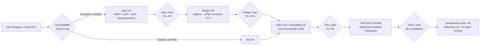

# Spec-to-Code Blueprint & 3-Layer Coding Standards Quality Stack

> Native subsystems in `neoagent/devops/blueprint/` and `neoagent/devops/standards/` — designed to **maximize LLM reasoning & implementation effectiveness** while enforcing deterministic, zero-dependency engineering gates.

---

## 1. Why AI Coding Drifts Without Contracts

When an LLM jumps straight from a one-sentence prompt to editing source files, three failure modes compound:

1. **Silent Requirement Guessing**: Ambiguous edge cases, concurrency budgets, and modification baselines get invented silently inside code.
2. **Context Pollution & Test Gaming**: Long multi-turn transcripts push the model past the `<40%` Smart Zone, and an implementer that writes both tests and code in one shared context tends to test its own bugs rather than the specification.
3. **Rubber-Stamped Clean Code**: Prompting "write clean code" without structural thresholds or AST verification produces deep nesting, boolean parameter traps, swallowed exception context, and speculative wrapper layers.

NeoAgent addresses all three natively through **Contract-First Blueprint Decomposition (`neoagent/devops/blueprint/`)** paired with a **3-Layer Coding Standards Quality Stack (`neoagent/devops/standards/`)**.

---

## 2. Spec-to-Code Blueprint Engine (`neoagent/devops/blueprint/`)



### 2.1 Five Durable Markdown Contracts

All cross-phase and cross-subagent handoffs happen via versioned files under `.neoagent-devops/artifacts/<loop-id>/blueprint/`:

| Artifact | Purpose | Key Invariants |
|---|---|---|
| `spec.md` / `lite.md` | **WHAT** to deliver | EARS phrasing (`shall`/`must`), `Given/When/Then` acceptance, `ChangeType` (`modify`/`remove` must cite `Existing Baseline`), ATAM 5-tuple QAS for NFRs, explicit `OpenQuestions` |
| `design.md` | **HOW** modules collaborate | 2–3 architectural options with trade-offs & selection provenance, single-sentence module responsibilities, **6-part observable interface contracts**, failure-path state guarantees, canonical **`TC-*`** test design table |
| `tasks.md` | **EXECUTION DAG** | `micro` vs `standard` granularity, topological `depends_on`, exact `create`/`modify`/`test` paths, `Consumes`/`Produces` signatures, `RED`/`GREEN`/`REFACTOR` + 5D `clean_code_check` ledger |
| `traceability.md` | **BIDIRECTIONAL AUDIT** | `Requirement -> Change Type -> Design Section -> TC-* -> Task T-* -> Source Files -> Test Files -> Verification Evidence` |
| `acceptance-cases.md` | **BLACK-BOX SIGN-OFF** | `AT-*` cases derived from `spec.md` (never reverse-engineered from implementation), Go / Conditional-Go / No-Go verdict, clean archive to `docs/specs/archive/` (excluding scratch `tasks.md`) |

### 2.2 Artifact-State Phase Router & Compaction Snapshot (`router.py`)

- **Zero-Loss Crash Recovery**: `detect_phase(workspace)` reconstructs the exact lifecycle stage (`spec` → `spec_gate` → `design` → `design_gate` → `plan_gate` → `develop` → `sdc_review` → `acceptance` → `complete` / `blocked`) purely from disk artifacts, gate records, and task statuses — even if an engineer edits `tasks.md` by hand.
- **6 Hard Lite-Upgrade Red Lines (`LiteEligibilityGate`)**: Even when `--lite` is requested, NeoAgent mechanically escalates to the full Blueprint track if risk tier is above `low`, blast radius exceeds 3 files / 80 lines, multiple top-level modules are impacted, public API/schema/auth boundaries are touched, or blocking ambiguities exist.
- **Ask, Don't Guess (`--strict-clarify`)**: An unquantified request (e.g. "make checkout fast") pauses synthesis with a blocking `OpenQuestion` and concrete options. Once answered (`--answer "OQ-001=p99 <= 200ms at 100 rps"`), the answer is folded into the vague requirement's statement and acceptance criteria, so the Spec Gate (`G3`, `G9`) can verify it instead of the model silently assuming a number.
- **Oversized Requirement Splitter (`GranularityAnalyzer`)**: Detects CRUD bundling (`G2`), scenario explosion (`G3`), and sync+async temporal coupling (`G6`), automatically splitting compound CRUD items into atomic EARS requirements while preserving `source_ref`.
- **Domain-Aware Compaction Snapshot (`build_compaction_snapshot`)**: Extracts a `<2400`-character summary (active phase, gate badges, task ledger, active task `Consumes`/`Produces`) during Context Reset so the `<40%` Smart Zone is preserved.

### 2.3 Independent Read-Only Phase Gates (`gates.py`)

| Gate | Checks | Blocks When |
|---|---|---|
| **Spec Gate (`G1`–`G9`)** | EARS syntax, `Given/When/Then`, vague-word ban (`fast`, `good performance` without numbers), `modify` baseline, QAS thresholds, `OpenQuestions` | Any blocking question is unanswered or acceptance is unquantified |
| **Design Gate (`G1`–`G15`)** | 100% Spec coverage, 6-part interface contracts, failure-path state guarantees, trade-off rationale, `G11`–`G14` `TC-*` validity + boundary/error + `modify` regression cases | Any requirement lacks design/`TC-*` coverage or error state guarantees are undefined |
| **Plan Gate (`P1`–`P6`)** | Kahn topological cycle detection, `plan TC-* == design TC-*` set equality, 100% requirement mapping, exact file/test paths, **Zero-Placeholder scan** (`TODO`/`TBD`/`similar to T1`/`同上`) | Task graph has cycles, omits a `TC-*` case, or leaves placeholders for subagents to guess |
| **3D Compliance (`S/D/C`)** | Spec (`S1`, `S5`), Design (`D1` planned interface symbols in code, `D3` no undeclared file edits), Component (`C1` all tasks passing) | Also runs automatically inside `ReviewProtocol` as contextual reviewer `blueprint-sdc` |

### 2.4 Maximizing LLM Effectiveness in Synthesis & TDD Execution

1. **AST-Grounded Cognitive Synthesis (`synthesizer.py`)**: Before calling the Reasoner model (`powerful_model`), `scan_repo_domain_context` extracts real AST classes/functions of target files, `AGENTS.md`, and test runner conventions so the LLM designs against actual symbols — falling back seamlessly to `DeterministicBlueprintSynthesizer` when offline.
2. **Complexity-Scaled Model Tiering (`ModelTierSelector`)**:
   - `micro` single-file tasks → `cheap_model` (single inline TDD session `micro_<loop>_<task>`)
   - `standard` multi-file tasks → `default_model`
   - High-fanout / multi-requirement tasks → `powerful_model`
3. **Red/Green Role Separation (`NeoAgentTaskImplementer`)**: For `standard` tasks, Session 1 (`red_<loop>_<task>`) is **strictly a test author** forbidden from touching production files; Session 2 (`green_<loop>_<task>`) implements minimal production code to turn Red's tests green without weakening assertions. Every session ID is recorded in `loop.evidence["author_sessions"]` and verified disjoint from reviewer sessions by `ReviewProtocol.attest`.
4. **Zero-History Context Packs (`compile_task_context_pack`)**: Each subagent receives only `task-T00k-brief.md` (its task slice + `TC-*` + `Consumes`/`Produces` + compiled 3-Layer Quality Stack), never prior chat history.

---

## 3. 3-Layer Coding Standards Quality Stack (`neoagent/devops/standards/`)

### 3.1 Three Orthogonal Layers (`stack.py`)

| Layer | Focus | Key Rules |
|---|---|---|
| **Layer 1 · 5D Clean-Code Floor** | Universal code quality | **Simplicity** (YAGNI, single responsibility), **Reliability** (explicit error paths, resource cleanup), **Maintainability** (intent-revealing names, nesting `<=4`, params `<=6`, function `<=80` lines), **Testability** (assert observable behavior, deterministic), **Performance** (no N+1 or sync blocking in async), **Scope Discipline** |
| **Layer 2 · 7-Rung Minimal-Code Ladder** | Solution shape | `Delete/Reuse -> Stdlib -> Platform -> Installed Dep -> Declarative Config -> Minimal Custom Code`, bounded by a **Never-Cut Safety Floor** (never cut boundary validation, auth, or data-loss error handling). Shortcuts require `# debt: <ceiling>, revisit when <trigger>` |
| **Layer 3 · Language Guardrails** | Language-specific traps | Built-in public-standard guardrails for **Python, TypeScript, JavaScript, C++, C, Go, Rust, Java, SQL** + repository `AGENTS.md` + `SkillRegistry` |

`CleanCodeCheck.validate()` mechanically rejects empty or rubber-stamped self-checks (`"ok"`, `"looks clean"`, `"lgtm"`), requiring concrete verification notes across all six dimensions before a task can transition to `passing`.

### 3.2 Deterministic Clean-Code & Language Reviewer (`inspector.py`)

`CleanCodeReviewer` (`deterministic=True`, `attributable=True`) runs inside the default Governed Review chain at zero LLM cost and participates in **change attribution** (pre-existing legacy smells are downgraded to `carried_over`; newly fixed smells are credited as `fixed_by_change`):

| Rule ID | Standard | Catches |
|---|---|---|
| `cc-long-function` | Clean Code | Functions exceeding line budget (`>80` minor, `>120` major) |
| `cc-deep-nesting` | Clean Code | Control-flow nesting deeper than 4 levels |
| `cc-high-complexity` | McCabe | Cyclomatic complexity exceeding threshold (`>12` minor, `>20` major) |
| `cc-too-many-params` | Clean Code | Functions taking `>6` positional parameters |
| `cc-boolean-trap` | Clean Code | Public functions exposing multiple positional boolean default flags |
| `cc-untracked-debt` | Minimal-Code Debt Rule | `# debt:` / `# lazy:` shortcut markers missing a ceiling and revisit trigger |
| `py-wildcard-import` | PEP 8 | `from module import *` outside `__init__.py` |
| `py-mutable-class-attr` | PEP 8 / Clean Python | Unannotated mutable list/dict/set on class body shared across instances |
| `py-finally-jump` | Python Language Ref | `return` / `break` / `continue` inside `finally:` discarding active exceptions |
| `py-reraise-without-context` | PEP 3134 | Raising a new exception inside `except` without `from err` or `from None` |
| `py-async-blocking-call` | Python `asyncio` | Synchronous blocking `time.sleep` / `requests.*` / `subprocess.*` inside `async def` |
| `py-late-binding-closure` | Python Gotchas | `lambda` capturing loop variable by reference inside `for` / comprehensions |

---

## 4. CLI, MCP & Studio Usage

```bash
# 1. Inspect compiled 3-Layer Quality Stack for target languages
neo-devops standards --files svc/pricing.py web/OrderCard.tsx --stage build

# 2. Create loop -> synthesize Blueprint -> execute isolated TDD tasks -> S/D/C gate -> Acceptance & archive
neo-devops new "Add tiered volume discount" --files svc/pricing.py tests/test_pricing.py
neo-devops blueprint <loop_id> --req "Apply 10% discount when quantity >= 10"
neo-devops next-task <loop_id>
neo-devops gate <loop_id> --phase sdc
neo-devops acceptance <loop_id> --cmd "python -m pytest tests -q"
```

- **Studio UI**: Select any loop in **NeoAgent Studio** to inspect the live Blueprint Phase Router, `SPEC` / `DESIGN` / `PLAN` / `SDC` gate badges, Task DAG progress, and click **需求蓝图 / 推进 TDD 任务 / S/D/C 审查 / 验收归档**.
- **MCP Tools**: `devops_blueprint`, `devops_phase_gate`, and `standards_compile` are exposed natively over `neoagent-mcp`.
