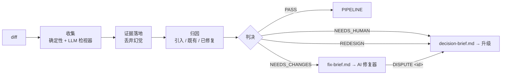

# 治理型检视协议（Governed Review Protocol）

> 让「一次检视」变成「一份可以被相信的检视」。实现位于 `neoagent/devops/review/`，默认启用，零 LLM 依赖即可运行。

多数 AI 评审工具把精力放在**如何找出更多问题**。真实团队里更常见的失败是另外三件事：

1. 评审者说自己是独立的，但没人能证明；
2. 评审把作者**没写过**的老问题算到这次变更头上，开发者很快学会无视评审；
3. 评审是流式的聊天，没有一份能回答“谁在什么输入下看过、每条意见后来怎么样了”的记录。

检视协议不增加检视器的数量，而是给检视加上五条**机械执行**的不变量。

---

## 五条不变量

| # | 不变量 | 怎么保证 | 代码 |
|---|---|---|---|
| 1 | **独立性被证明，而不是被宣称** | 每轮写入一份证明：评审者实际收到了什么输入（diff + 技能包的摘要）、运行在哪些会话、是否与作者会话重叠、是否声明了作者对话/推理等禁用输入。`harness-audit` 读取实测结果；尚无评审时报告 `未知`，而不是默认 `True` | `protocol.py::ReviewProtocol.attest` · `engine.py::_measure_isolation` |
| 2 | **有证据才有意见** | 生成式（LLM）发现必须落在 diff 的真实新增行上：文件须在 diff 中、行号须是新增行（±2 行容差自动吸附）、引用的原文须真实存在。落不了地的发现被丢弃并**计数**，丢弃率就是一项可审计的幻觉指标 | `grounding.py` |
| 3 | **只追究这次变更的责任** | 把 diff 反转（`+`↔`-`），用同一批确定性检视器扫描“旧代码”，再与新侧发现按（规则、文件、证据相似度）匹配：无对应 → `introduced`；有对应 → `carried_over`；旧有而新无 → `fixed_by_change`。既有问题默认降级为 INFO，不再阻塞合入；CRITICAL 永不降级 | `attribution.py` |
| 4 | **按“谁有权决定”分流** | 每个发现带路由类别：AI 可修（`llm_fixable` / `spec_mismatch`）回到 BUILD；需要业务事实或架构裁决（`user_input` / `human_decision`）不再让修复器去猜，而是产出**决策简报**升级给人；缺陷在上游（规格/设计）时判决为 `REDESIGN`，不再对着代码打补丁 | `protocol.py::decide_verdict` · `build_decision_brief` |
| 5 | **发现不能无故消失** | 生成式评审的发现若只是“这轮没再提”，而被引用的代码仍原样存在，则保持 OPEN——评审器的随机波动不等于修复。确定性检视器的沉默仍然是有效证据 | `protocol.py::offending_code_unchanged` · `engine.py::_merge_findings_on_rereview` |

---

## 判决与流转



| 判决 | 条件 | 动作 |
|---|---|---|
| `PASS` | 门禁通过 | 前进到 PIPELINE |
| `NEEDS_CHANGES` | 所有阻塞项都可由 AI 修复 | 回到 BUILD，附带 `fix-brief.md` |
| `NEEDS_HUMAN` | 存在需要业务事实或裁决的阻塞项（含被作者申诉的发现） | 写 `decision-brief.md`，升级给负责人 |
| `REDESIGN` | 阻塞项的 `rework` 指向 `spec` / `design` | 同上；不再自动改代码 |

决策简报把需要人回答的内容压缩成**最少的具体问题**，每个问题附选项，例如“公开函数签名发生不兼容变更：(a) 保留旧签名；(b) 接受破坏并列出所有调用方”。

---

## 评审接收协议（Review Reception）

修复器拿到 `fix-brief.md` 后遵循：

1. **先验证再动手**：对照真实代码确认发现成立；
2. **不做表演式附和**：要么修，要么申诉；
3. 发现不成立时**不为迎合评审而改代码**，输出一行 `DISPUTE <finding-id>: <能推翻它的具体证据>`；
4. 发现成立时只做最小改动、一次一条、补回归测试；
5. 需要业务决定时写 `DISPUTE <id>: needs-owner-decision — <问题>`。

申诉由引擎落地（`engine.respond` / `neo-devops respond`）：发现**保持 OPEN**（作者无权自行关闭），类别改为 `human_decision`，下一轮判决为 `NEEDS_HUMAN`，申诉理由原文进入决策简报。幻觉出来的发现编号会被忽略，不会让闭环崩溃。

---

## 规则目录（Rule Catalog）

“说不出依据的评审意见只是观点”。`neo-devops rules` 列出全部规则及其出处：

| 字段 | 含义 |
|---|---|
| `dimension` | 风险维度：security / correctness / contract / test-integrity / process … |
| `standard` | 公开出处：CWE 编号、语言规范或团队流程条目 |
| `triage` | 谁可以修：AI 或人 |
| `rework` | 若问题不在代码：回到哪个阶段（build / spec / design） |
| `aliases` | LLM 随意起的规则名到标准规则的映射，让生成式发现也能被归类并附上出处 |

目录同时驱动 **SARIF 2.1.0** 输出：规则标题、CWE 标签与属性随结果导出，代码扫描面板可按 CWE 聚合，而不是面对一堆不透明的规则字符串。

---

## 检视器

全部在默认检视链中，确定性、毫秒级、零 LLM 成本：

| 检视器 | 关注点 | 示例规则 |
|---|---|---|
| `SecurityReviewer` | 21 条带 CWE 引用的安全规则（Python / JS / Java / XML）；带密钥语境的弱哈希自动升级严重度；`--deep` 审计整个被触达文件，**旧问题记为安全债务而不是阻塞项** | `sec-weak-cipher` · `sec-jwt-unverified` · `sec-ssrf` · `sec-archive-extract` |
| `ScopeDriftReviewer` | 修改了变更声明范围之外的文件。源码越界阻塞，配置/CI 元数据仅提示 | `scope-drift` |
| `TestEvidenceReviewer` | 生产逻辑变了，却没有任何测试一起变 | `change-without-tests` |
| `ContractDriftReviewer` | 公开函数被删除或签名发生不兼容变化（追加带默认值的参数视为兼容） | `public-api-removed` · `public-contract-change` |
| `WeakTestReviewer` | 新增测试“看起来在测，实际不会失败”：无断言、恒真断言、只断言非 None | `test-without-assertion` · `tautological-assertion` |
| `StaticASTReviewer` · `BugPatternReviewer` | 既有的确定性底座与仓库缺陷模式记忆 | — |
| `SkillOrchestratedReviewer` | 三视角并行 LLM 评审，提示词要求“怀疑者式阅读”、优先读错误路径、必须引用原文 | — |

检视器通过四个属性向协议声明自己的性质：`deterministic`（沉默即证据）、`attributable`（可在旧代码上重放）、`reads_worktree`、`context_inputs`（它收到了什么）。第三方检视器只需声明这几项即可获得归因与独立性证明。

---

## 每轮检视记录

每轮写入 `review-record-r<N>.md`（人读）并追加 `review-record.json`（机读），内容：

- 判决、质量星级、风险等级、变更行数；
- **独立性证明**：检视器、输入、输入摘要、检视/作者会话、是否隔离；
- **责任划分**：本次引入 / 既有 / 本次修复 / 安全债务；
- 被丢弃的无依据发现数量及原因、被保持 OPEN 的“消失发现”数量；
- **逐条发现及其处置**：ID、严重度、规则、出处、位置、归因、类别、状态、处置说明（已修复 / 已豁免 / 被申诉）。

记录只保存相对路径，不写入任何工作站绝对路径。

---

## 使用

```bash
neo-devops review <loop>                  # 默认即启用协议；输出判决与归因统计
neo-devops review <loop> --deep           # 深度审计：旧问题记为债务
neo-devops review-record <loop> [--round N]
neo-devops respond <loop> <finding> --by me --reason "调用方已校验，见 test_x"
neo-devops rules                          # 规则目录
neo-devops harness-audit                  # L5 独立性来自实测，违例时退出码为 2
neo-devops metrics                        # 含“评审可信度”聚合
```

`devops.toml`：

```toml
[review]
attribution = true               # 引入 / 既有 / 已修复
carried_over_policy = "downgrade" # downgrade | keep | drop
ground_llm_findings = true       # 丢弃无依据的 LLM 发现
scope_drift = true
deep_audit = false
verify_vanished = true
write_record = true
```

## 度量

`neo-devops metrics` 的“评审可信度”：

| 指标 | 含义 |
|---|---|
| 隔离率 | 有证明的评审轮次中，独立性成立的比例 |
| 归责精度 | introduced / (introduced + carried_over)，越高说明评审越少冤枉作者 |
| 幻觉丢弃数 | 被证据落地过滤掉的 LLM 发现 |
| 标准引用率 | 阻塞项中带有公开出处的比例 |
| 判决分布 | PASS / NEEDS_CHANGES / NEEDS_HUMAN / REDESIGN |

## 设计取舍

- **确定性优先**：能用规则证明的，不交给模型；模型只补充规则覆盖不到的部分，并被证据落地约束。
- **宁可升级，不要乱改**：对业务事实与架构裁决，AI 修复器的“自信”比人工等待更危险。
- **向后兼容**：`StepResult` 的退出码契约、`fix-brief.md`、SARIF、MR 评论产物保持不变，协议只在其上增加字段与产物。
